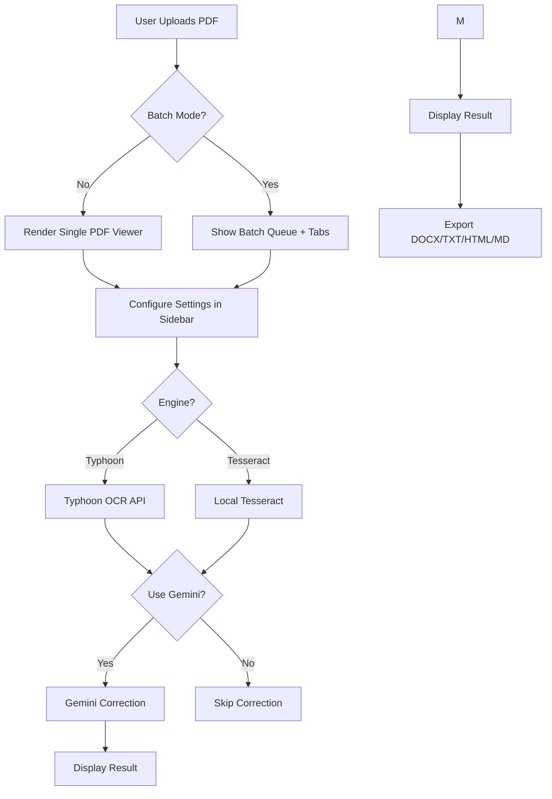

# System Patterns — MyOCR PDF

## Architecture
Single-file Streamlit app with modular functions:

## Key Patterns
- **Session State:** All mutable state stored in `st.session_state`
  - Batch: `batch_mode`, `uploaded_files`, `batch_results`, `batch_processing_status`, `active_batch_tab`
  - Theme: `theme_mode` ("dark" | "light")
  - Language: `detected_language`
- **Caching:** `@st.cache_data` with `max_entries` and `ttl` for export functions
- **Progress Callback:** `progress` object passed to `extract_pdf()` for real-time updates
- **Progress ETA Wrapper:** `_ProgressWithETA` class wraps progress widget to add time estimates
- **CSS Injection:** Dual-layer — `inject_css()` (base dark) + `inject_theme_override_css()` (light mode + Phase 3 components)
- **PDF Viewer:** Skeleton loader with spinner animation (hidden when EmbedPDF initializes)
- **Undo/Redo Stack:** FIFO stack (max 50 entries) tracking OCR editor text changes, triggered by `_prev_ocr_editor` comparison. Undo button handler uses `st.rerun()`.
- **Multi-format Export:** Factory pattern — `export_txt_file()`, `export_html_file()`, `export_markdown_file()` share cached export logic with format selector routing in download section
- **Keyboard Shortcuts:** JavaScript injected via `components.html()` intercepting Ctrl+Z, Ctrl+S, Esc keys
- **OCR Confidence Scoring:** `_calculate_ocr_confidence(text)` uses 4-factor heuristic (Thai char ratio, text length, error markers, line structure) → returns overall score, per-page breakdown, colored badge HTML
- **Auto Language Detection:** `_detect_language(text)` uses `langdetect` library with fallback character-ratio heuristic
- **Batch Processing:** Sequential OCR loop — each file processed individually, results stored in dict keyed by index, ZIP download wraps all `.txt` results

## Component Relationships
- Sidebar settings → affect OCR behavior (engine, language, mode) + Phase 3 controls (batch toggle, theme picker)
- Main content → PDF viewer + OCR result editor side-by-side (single mode) OR batch tabs with per-file editors (batch mode)
- Download section → appears only after successful OCR with format selector dropdown
- Page selection → in main content (where `total_doc_pages` is available) with visual feedback badge
- Stats banner → rendered inside `ocr_preview` container after OCR completion, now includes confidence badge + language detection
- Batch queue → sidebar checkbox enables multi-file uploader, shows status badges per file
- Theme toggle → radio buttons in sidebar trigger CSS override injection via `inject_theme_override_css()`

## Phase Progress
- ✅ Phase 1: Quick Wins (dark theme consistency, loading states, progress ETA)
- ✅ Phase 2: Enhanced UX (undo/redo, stats banner, multi-format export, keyboard shortcuts)
- 🚧 Phase 3: Advanced Features (batch processing, confidence score, theme toggle, language detection) — CORE IMPLEMENTED
